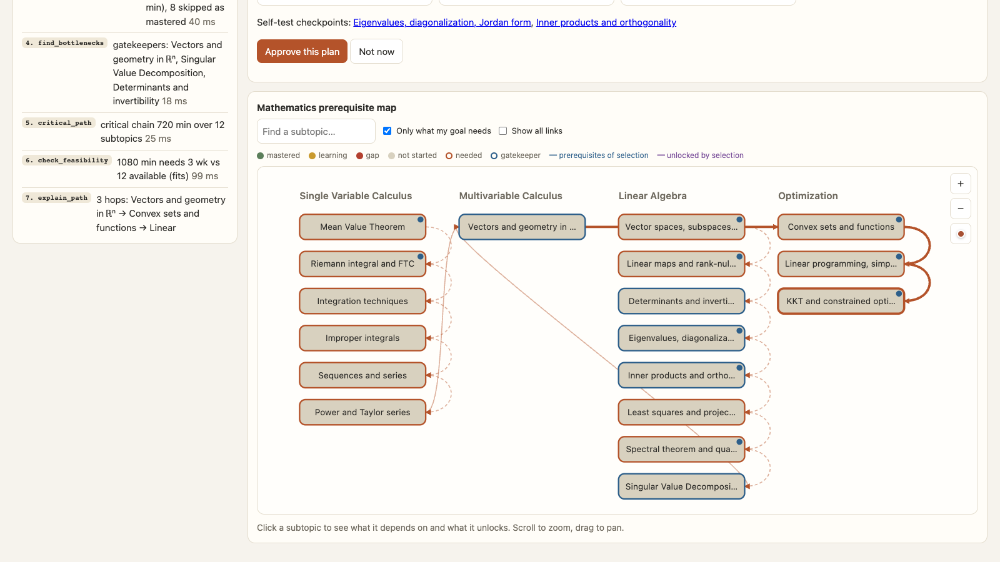

# From “I want to learn this” to “here’s your next lesson”

## Building Studyspace with FalkorDB at Graph Hacks

By Nimesh and the Studyspace team · October 18, 2026 · Build story

You decide to learn something new. You find a tutorial, start watching, and five minutes later there is a term you have never seen before. So you open another tab. Then another.

The problem is finding the right starting point. A list of resources helps only so much when you do not know which foundations you are missing.

That is the problem we worked on with **Studyspace**, our submission for **Graph Hacks: Context for AI Agents**, organized by WeMakeDevs and sponsored by FalkorDB. We entered the **Agents That Act on Connected Data** track.

Studyspace is a learning desk where a student can enter a goal, see the foundations behind it, approve a study plan, and continue with the next unfinished lesson. FalkorDB supplies the connected curriculum and persistent learner context that make that workflow possible.

[Watch the working demo](https://youtu.be/HcYy9IaRaig) · [Explore the source code](https://github.com/wmd-graph-hacks/wmd_oct15) · [Hackathon](https://www.wemakedevs.org/hackathons/falkordb)

## Why we started with relationships

Take a goal like understanding KKT conditions for constrained optimization. The target has foundations across calculus, linear algebra, and optimization. Some students already understand those foundations. Others need to work through them first.

A useful planner needs to answer several questions together:

- Which lessons lead to this goal?
- Which prerequisites has this learner already mastered?
- What remains, and in what order should it be studied?
- Which concepts hold up progress through the rest of the plan?
- Does the workload fit the available study time?

Those are relationship questions. We represented the curriculum as a graph in FalkorDB, then built tools that retrieve and operate on those connections.

The lesson text still matters. But the prerequisite edges explain why one lesson should come before another. That structure gives the agent a basis for a recommendation that we can inspect.

## What actually lives in FalkorDB

Studyspace has a shared curriculum graph and learner-specific state. The curriculum includes courses, topics, subtopics, prerequisite edges, and lesson passages. The learner state includes knowledge evidence, quiz activity, agent runs, plan proposals, and saved progress.

A simplified view of the shared graph looks like this:

```text
(Course) ── curriculum ──> (Topic) ── curriculum ──> (Subtopic)
                                                      │
                                                 HAS_CHUNK
                                                      ↓
                                                   (Chunk)

(Subtopic) ── PREREQUISITE_OF ──> (Subtopic)
```

The curriculum arrows above describe the hierarchy conceptually; HAS_CHUNK and PREREQUISITE_OF are relationship names used by the application. Learner state is stored separately from the shared curriculum so one student's progress does not alter the course for everyone else.

Firebase Authentication verifies identity. The backend uses that verified UID to scope learner data. FalkorDB holds the planning context and persistent learning records. Keeping those responsibilities explicit helped us reason about returning users and saved plans.

## Following a goal backwards through the graph

The planner first resolves a goal to curriculum subtopics. It retrieves the learner's current state and then finds the prerequisite closure for the target.

Here is the core traversal pattern from our implementation, with the relationship filters expanded for readability:

```cypher
MATCH (t:Subtopic)
WHERE t.id IN $targets
MATCH p=(pre:Subtopic)-[:PREREQUISITE_OF*1..20]->(t)
WHERE NOT pre.id IN $mastered
  AND all(r IN relationships(p)
    WHERE r.status IN ['curated', 'approved']
      AND coalesce(r.scope, '') <> 'course')
  AND all(n IN nodes(p)[1..size(nodes(p))-1]
    WHERE NOT n.id IN $mastered)
RETURN DISTINCT pre.id, pre.title, pre.estimated_minutes,
                pre.topic_order, pre.order
```

Targets and mastered IDs are bound parameters. The query limits prerequisite paths to 20 hops and filters the relationship status and scope. The implementation also adds an unmastered target itself to the result.

There is an important modeling choice here: a mastered intermediate lesson cuts the traversal along that path. This treats recorded mastery of that lesson as sufficient evidence for its earlier foundations. That is a prototype assumption we would want to evaluate with actual learners.

The query is in [app/kg/queries.py](https://github.com/wmd-graph-hacks/wmd_oct15/blob/main/app/kg/queries.py), alongside the other graph retrieval functions.

## Turning retrieved context into a plan

Retrieving prerequisites is the first step. We then use the retrieved graph to produce a practical order and estimate the work involved.

- **Dependency order:** Python applies Kahn's topological sort to the relevant graph, using curriculum order to break ties.
- **Gatekeepers:** the planner identifies concepts that support later parts of the required learning path.
- **Critical path:** an application-side algorithm calculates the longest prerequisite chain using estimated lesson durations.
- **Feasibility:** total estimated study time is compared with the learner's hours per week and weeks available.

FalkorDB provides the nodes, relationships, and learner evidence. The controller coordinates retrieval and application-side calculations through named tools. We are careful about that distinction: the database supplies the connected context; the scheduling and graph calculations also include Python logic.

For the demo, we use a synthetic learner called Alex with explicitly seeded mathematics history. We ask for a plan for KKT conditions with six hours a week and twelve weeks available. The planner uses Alex's saved knowledge state to determine which foundations remain.

The screen shows the retrieved dependency map and a tool trace. You can see which targets were resolved, which prerequisites were needed, and how the planning tools were called. That visibility was a big part of what we wanted to build.



## The agent proposes; the student approves

We separated generating a plan from committing it.

Both the optional LLM controller and the deterministic controller call the same tool layer. They can propose a plan. Activating that proposal requires the student's approval through a separate endpoint.

After approval, the dashboard shows the saved lessons and progress. “Continue learning” opens the next unstudied lesson. On a later visit, the student can pick up from the saved plan.

We also kept two facts separate: **studied** and **mastered**. Marking a lesson as studied records that the learner worked through it. Quiz evidence updates the mastery estimate. Clicking a completion button should not silently become proof of understanding.

Saved-plan reads and writes are scoped to the signed-in learner. Completion is idempotent, so repeating the same action does not add duplicate progress.

## Where the LLM fits

The optional Gemini integration uses LiteLLM and the graph tool layer. The controller is instructed to work with retrieved curriculum IDs and evidence, and the backend validates the proposed output.

If the provider is unavailable or the output fails validation, a deterministic playbook runs the graph workflow. That path is also useful for debugging, because the sequence of tool calls is easier to reproduce.

**The recorded demo uses the deterministic controller.** It shows real application endpoints and FalkorDB data with a synthetic learner. It does not present a staged model response as a live LLM run. The Google sign-in interface is shown, but the recording uses an isolated development demo session rather than recording a personal Google consent flow.

Studyspace also includes a tutor that retrieves lesson passages and expands context over prerequisites. With AI enabled, the answer must cite retrieved passages. An extractive fallback is available when a generated answer cannot be accepted. This helps keep the tutor tied to the supplied curriculum, although it does not make the curriculum automatically correct.

## What took more care than we expected

The graph model was only part of the work. We also had to connect authentication, first-time onboarding, saved plans, and lesson progress into a coherent product flow.

A successful sign-in needs to lead somewhere useful. New users complete a profile; returning users get their saved dashboard. A plan needs an approval step, a lesson page, and a way to resume. Those details are what turn a planning response into a usable learning workflow.

Another lesson was to be precise about data quality. The prototype contains nine subject areas, but content depth and prerequisite quality vary. Authored dependencies and inferred ordering are different kinds of evidence. A polished graph visualization does not establish that every edge is pedagogically sound.

FalkorDB made the connections accessible to our application. We still have to take responsibility for the content and assumptions we put into that graph.

## What we would improve next

The next step is to evaluate the learning path with real students and subject experts. We would review prerequisite edges, improve lesson and question quality, and measure whether recommendations help learners make progress.

We also want stronger handling of uncertain mastery, more useful diagnostics for graph-data issues, and better feedback when a goal cannot be resolved to the available curriculum. Scheduling estimates should eventually account for individual pace rather than treating lesson durations as fixed.

We have not established learning-outcome gains or production-scale performance. This is a working hackathon prototype, and those are questions for further evaluation.

## What we are taking away from the hackathon

The most useful part of FalkorDB for this project was being able to connect a goal, its foundations, and a learner's evidence in an inspectable workflow. That context supports the explanation, the plan, and the student's next action.

For us, the satisfying moment was seeing the whole loop work: enter a goal, follow the prerequisite graph, approve a plan, study a lesson, and return to saved progress.

There is plenty left to improve. But Studyspace now has a concrete answer to the question we started with: “What should I learn next, and why?”

## Try it locally

The public repository includes setup instructions, configuration notes, graph queries, and the application source. A local FalkorDB instance is required for the standard setup.

```sh
git clone https://github.com/wmd-graph-hacks/wmd_oct15.git
cd wmd_oct15
cp .env.example .env
docker compose up -d falkordb
python3.11 -m venv .venv
source .venv/bin/activate
pip install -e .
uvicorn app.main:app --reload
```

Set AUTH_MODE=demo and AI_ENABLED=false in your local .env for the deterministic local walkthrough. Open http://localhost:8000. Google sign-in and optional Gemini calls require the additional configuration documented in the project README. Never publish API keys or service-account credentials.

## Links and disclosure

[Source and setup](https://github.com/wmd-graph-hacks/wmd_oct15) · [Demo video](https://youtu.be/HcYy9IaRaig) · [FalkorDB](https://www.falkordb.com/) · [Graph Hacks rules](https://www.wemakedevs.org/hackathons/falkordb/rules)

This post documents our Graph Hacks project. AI tools assisted with coding, debugging, drafting this article, and producing demo narration and cover artwork. The technical descriptions are grounded in the implementation; the demo learner and its initial history are synthetic. This is a hackathon submission, and no prize or endorsement is implied.
